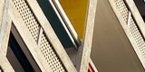
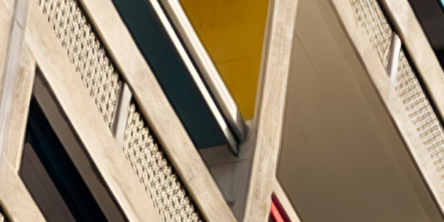
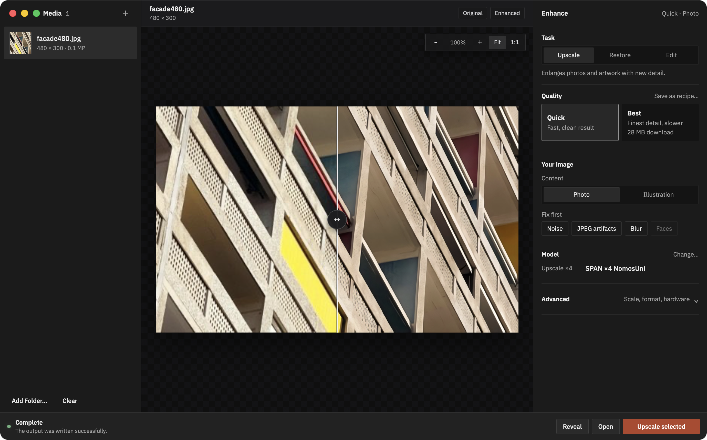
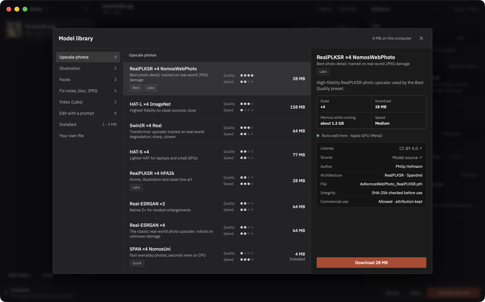

# LocalSR

**Enlarge photos and restore images on your own computer.**

LocalSR is a free desktop app for upscaling photos, cleaning up noise and blur,
and enhancing video. Choose an image, pick Quick or Best, and compare the result
with your original. The models run on your computer; your photos stay there too.

[**Download LocalSR**](https://herrei.github.io/localsr/download/) ·
[Try it in your browser](https://herrei.github.io/localsr/demo/) ·
[Website](https://herrei.github.io/localsr/) · [User guide](https://herrei.github.io/localsr/guide/) ·
[Changelog](CHANGELOG.md)

| Original detail | LocalSR, 4× with Quick |
| --- | --- |
|  |  |

*An actual result from SPAN NomosUni, with no added sharpening. Photo by
[Tim Ziegelbaum](https://unsplash.com/photos/modern-apartment-building-with-colorful-balconies-against-blue-sky-n4bofMDUS_Y).
[Image credits and processing details](docs/assets/README.md).*

## New in 0.2: a calmer window



Version 0.2 redesigns the window for people who open LocalSR for the first
time. There is one way to start: add a photo, choose Quick or Best and press
the button at the bottom right. If a model is missing, that button says so
("Download 4 MB, then upscale") and does both. Quick and Best are described by
what you get rather than by model name, Upscale handles videos too, and the
top bar is gone: the model library, performance and updates live in the menu
bar. The app ships IBM Plex Sans, uses square corners and neutral greys, and
keeps colour for the button that starts work. New installations start on the
GPU. [Release notes](docs/releases/v0.2.0-beta.md).

0.2.1 keeps the comparison divider in place while you zoom, so a close look
still shows before and after side by side. Original · Split · Enhanced above the
preview switches between the whole original, the divider and the whole result,
and holding M shows the original from any view.
[Release notes](docs/releases/v0.2.1-beta.md).

0.2.2 compares a finished video the way it compares a photo: the same
canvas, a divider that stops at the edges of the frame, zoom with 1:1, and
playback controls below the picture. Space plays and pauses.
[Release notes](docs/releases/v0.2.2-beta.md).

## Download

The [download page](https://herrei.github.io/localsr/download/) has the installers
and instructions for each platform:

- **macOS v0.2.2-beta:** Apple Silicon, macOS 14 or later. Signed and notarized
  by Apple, with signed updates in the app.
- **Windows v0.2.2-beta:** Windows 10 or 11, x86-64. CPU, DirectML and NVIDIA
  CUDA editions; the GPU editions are labelled untested. Installers are unsigned.
- **Linux v0.2.2-beta:** x86-64 AppImages for CPU, AMD ROCm and NVIDIA CUDA.
  ROCm was tested on a Radeon RX 9060 XT with earlier builds; CUDA is untested.

Editing with a prompt is available on the Mac only.

The larger GPU editions come in parts. The download page explains how to put
these together. See [platform support](docs/platforms.md) for the testing details.

Models download when you need them. Quick needs about 4.5 MB; other models can
be much larger.

## What you can do

- **Enlarge photos and artwork** by 2×, 3× or 4×. Quick is a good starting point;
  Best spends more time on photo detail.
- **Clean up noise, blur and JPEG artifacts** before enlarging. Face restoration
  is available with compatible models.
- **Watch the result take shape.** Finished tiles appear as the job runs. When
  it finishes, drag the comparison slider to see what changed, or switch
  between Original, Split and Enhanced above the preview. The slider stays in
  place while you zoom in, and holding M shows the original. Large exports
  get a smaller preview while the saved file keeps every pixel.
- **Process a folder** or build a queue of images and videos. Save a setup as a
  recipe if you want to use it again.
- **Edit with a prompt.** Describe a change and a local Qwen Image Edit or
  FLUX.2 klein model creates a new image. This is experimental; FLUX.2 klein
  Q4_0 at 512 px has been tested on a 16 GB M1 Pro. The editing models are
  separate downloads of 5–26 GB. [About editing](docs/image-editing.md).
- **Enhance video** frame by frame, keeping the source timing, rotation and
  audio. SeedVR2, HDR preservation and other Labs options still need more
  testing. [Video support](docs/video-support.md).
- **Automate jobs** with the `localsr` command, including watch folders and
  CPU/GPU benchmarks. [Command line guide](docs/automation.md).

JPEG, PNG, WebP, TIFF, AVIF, GIF, JPEG 2000 and camera RAW files are supported.
On macOS, HEIC/HEIF and JPEG XL open through the system decoders. You can save
images as PNG, JPEG, TIFF or WebP. [Metadata and colour](docs/metadata.md).

## Choose a model

You can start with the presets and explore the library later. Each model shows
its download size, license, source and estimated memory use. LocalSR checks
curated downloads against their expected size and SHA-256 checksum before use.
You can also import your own compatible `.safetensors` files.



Quick uses SPAN NomosUni and Best uses RealPLKSR NomosWebPhoto, both by
Philip Hofmann under CC BY 4.0. The library also includes HAT, Real-ESRGAN,
SwinIR, NAFNet, SCUNet and FBCNN. The two HAT face companions require a manual
import because their checkpoint rights are unresolved.
[Model guide](docs/models/README.md) · [Model licenses](docs/model-licenses.md).

## What to expect

The Mac build gets the most testing, on an M1 Pro with 16 GB of memory.
Windows and Linux have automated package checks and some hardware testing;
they have not had the same manual coverage.

Try a small image or a short clip first to get a feel for the speed. Large
images and video can take hours. More memory helps, but a particular model or
video job may still be too demanding for your computer.
[Known limitations](KNOWN_LIMITATIONS.md).

AI upscaling reconstructs detail. It can make a photo look clearer, but it
cannot tell you exactly what was in the original scene. Keep your originals.

## Privacy

There is no account. Your images and videos are processed locally and never
uploaded. The app connects to download models you choose and to check for
updates at launch.

The update check includes an anonymous count: app version, platform and channel,
with no identifier. Turn off *Send an anonymous update-check count* in the
Software Update dialog if you prefer. *Copy diagnostics* includes versions,
hardware and memory figures, without file names or media.
[Privacy details](https://herrei.github.io/localsr/privacy/).

## Build from source

You need Python 3.11, Node.js, a stable Rust toolchain and
[Tauri's platform prerequisites](https://v2.tauri.app/start/prerequisites/).

```sh
./local-ci.sh setup
cd desktop && npm run tauri -- dev
```

The interface uses Svelte and Tauri, with a Rust host for the queue, settings,
file access and updates. A separate Python worker runs PyTorch and Spandrel.
If inference fails, the host can restart the worker.
[Desktop guide](desktop/README.md) · [Worker protocol](protocol/README.md).

Run `./local-ci.sh` for the local checks. Packaging and signing are covered in
[Releasing](docs/releasing.md). The [command line](docs/automation.md) also works
without the desktop interface.

## Feedback

Please report bugs on [GitHub Issues](https://github.com/HerRei/local-upscale/issues)
with your app version, model, device and the steps that led to the problem.
*Copy diagnostics* supplies the hardware details. For security reports, see
[SECURITY.md](SECURITY.md). For anything else:
[hermes.reisner@gmail.com](mailto:hermes.reisner@gmail.com).

## License

LocalSR is [MIT licensed](LICENSE). Models keep their authors' licenses, shown
in the app before download. Bundled libraries are listed in
[THIRD_PARTY_NOTICES.md](THIRD_PARTY_NOTICES.md), and each release includes the
corresponding source for its LGPL components.
