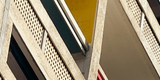
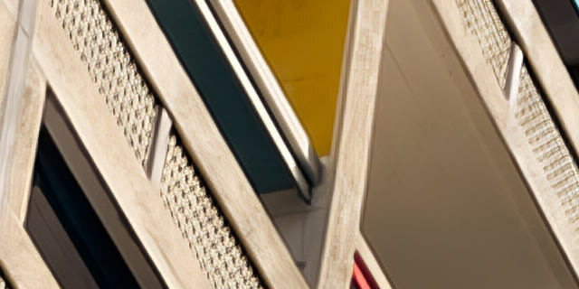
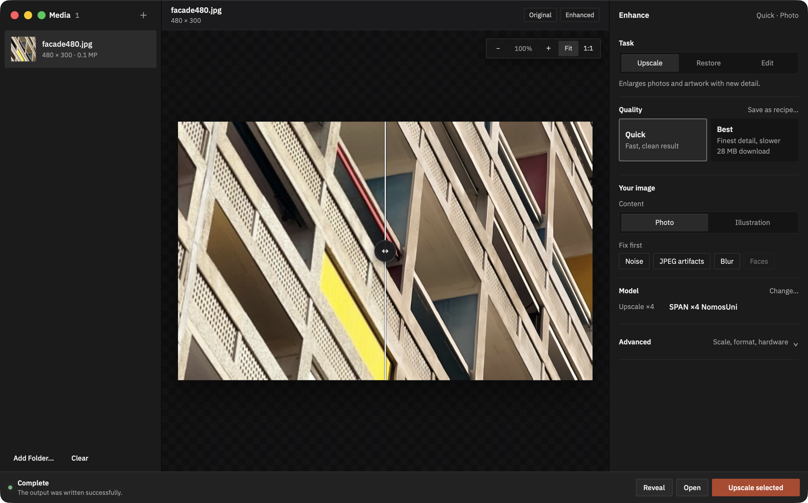

# LocalSR

LocalSR is a free desktop app for upscaling photos, cleaning up noise and blur,
and enhancing video. Choose an image, pick Quick or Best, and compare the result
with your original. The models run on your computer, and your photos stay there too.

[Download](https://herrei.github.io/localsr/download/) ·
[Try it in your browser](https://herrei.github.io/localsr/demo/) ·
[Website](https://herrei.github.io/localsr/) ·
[User guide](https://herrei.github.io/localsr/guide/) ·
[Changelog](CHANGELOG.md)

| Original detail | LocalSR, 4× with Quick |
| --- | --- |
|  |  |

*A real result from SPAN NomosUni, with no added sharpening. Photo by
[Tim Ziegelbaum](https://unsplash.com/photos/modern-apartment-building-with-colorful-balconies-against-blue-sky-n4bofMDUS_Y).
[Image credits and processing details](docs/assets/README.md).*



## Why I built it

LocalSR started out of necessity. For a long time I upscaled pictures with the
HAT-L models, but only through the terminal. At some point I wanted a proper app
for it, and most of what I found was subscription-based, really complicated or
outdated. So the decision was clear. With the help of Claude and a clear idea of
what I wanted, I built a super-resolution app that puts research-level models in
one place and runs them on your own computer. The results are impressive, but
they are not my work. My work is making these niche but incredible models a lot
more accessible. They are meant to be used anyway: every model the app downloads
is published under an open licence (Apache-2.0, BSD-3-Clause, MIT or CC BY 4.0
at the moment), and the app shows you each licence before it downloads anything.

## What it does

- Enlarge photos and artwork by 2×, 3× or 4×. Quick uses a small, fast model,
  and Best a larger one made for real photos.
- Clean up noise, blur and JPEG artifacts first, then enlarge.
- Compare the original and the result with a slider, or hold M to see the
  original. Results are saved as new files, so your originals stay untouched.
- Enhance video frame by frame, with the source timing, rotation and audio kept.
- Process a whole folder or a queue, and save a setup as a recipe.
- Edit with a prompt, with FLUX.2 klein or Qwen Image Edit. This is
  experimental, and so far only FLUX.2 klein has been tested, on a 16 GB Mac.
  [About editing](docs/image-editing.md).

LocalSR also has a built-in benchmark. It times a real upscaling model on fixed
test images, through the same inference engine the app uses for your own files,
and reports how many megapixels per second your CPU or GPU can upscale. Local AI
benchmarks can be hard to grasp, so it's good to have one built around a real
use case.

It opens JPEG, PNG, WebP, TIFF, AVIF, GIF, JPEG 2000 and camera RAW files, and
on the Mac also HEIC and JPEG XL. It saves PNG, JPEG, TIFF or WebP. Videos can
be MP4, MOV, MKV, WebM and other common formats, and are saved as AV1, VP9 or
FFV1, or on the Mac also as HEVC. [Video support](docs/video-support.md).

Quick uses SPAN NomosUni and Best uses RealPLKSR NomosWebPhoto, both by Philip
Hofmann. The library also has HAT, Real-ESRGAN, SwinIR, NAFNet, SCUNet and
FBCNN, and each model shows its size, licence and source before you download it.
[Model guide](docs/models/README.md) · [Model licences](docs/model-licenses.md).

<!-- release-candidate -->
v0.3.1-beta to v0.3.5-beta are in preparation; the downloads below are still
v0.3.0-beta. Draft release notes: [v0.3.1-beta](docs/releases/v0.3.1-beta.md),
[v0.3.2-beta](docs/releases/v0.3.2-beta.md), [v0.3.3-beta](docs/releases/v0.3.3-beta.md),
[v0.3.4-beta](docs/releases/v0.3.4-beta.md), [v0.3.5-beta](docs/releases/v0.3.5-beta.md).
<!-- /release-candidate -->

## Download

The [download page](https://herrei.github.io/localsr/download/) has the installers
for each platform:

- **macOS v0.3.0-beta:** Apple Silicon (M1 or newer) and macOS 14 or later. Intel
  Macs are not supported. Signed and notarized, and it updates itself.
- **Windows v0.3.0-beta:** Windows 10 or 11 on x86-64, as CPU, DirectML and
  NVIDIA CUDA editions. DirectML and CUDA are untested. The installers are
  unsigned, so SmartScreen warns first: choose **More info**, then **Run anyway**.
  With AMD or Intel graphics, built-in ones included, take DirectML; the upcoming
  release also uses built-in graphics and runs Intel graphics through OpenVINO.
- **Linux v0.3.0-beta:** x86-64 AppImages for CPU, AMD ROCm and NVIDIA CUDA.
  CUDA is untested. In the upcoming release the CPU AppImage also runs Intel graphics
  through OpenVINO once Intel's compute driver (`intel-opencl-icd`) is installed.

On a Mac you can also install it with [Homebrew](https://brew.sh/):

```bash
brew install --cask herrei/tap/localsr
```

The Mac app takes about 1.2 GB, because it brings its own Python and PyTorch.
Models download when you choose them: Quick is 4.5 MB, most others are under
500 MB, and the editing models are 5 to 26 GB. I test upscaling on a Mac with
16 GB of memory.

LocalSR is only published on
[GitHub Releases](https://github.com/HerRei/local-upscale/releases), on
[herrei.github.io/localsr](https://herrei.github.io/localsr/) and through the
Homebrew cask, which all use the same files. Each file has a SHA-256 next to it.
The Mac app is signed as `Developer ID Application: Hermes Reisner (Z2TU844D84)`;
`spctl -a -vv /Applications/LocalSR.app` shows it.

## Limits

- Upscaling reconstructs detail. Faces, text and fine patterns can look sharp
  and still differ from the real scene, especially at 4×.
- Video is upscaled one frame at a time, so fine detail can flicker.
- Large images and long videos can take hours. Try a small one first.
- I test the Mac build the most, and only the Mac build updates itself.
- On Windows and Linux, phone videos (H.264, HEVC, AAC) need an FFmpeg you
  install yourself. On the Mac they open through the system.

The full list is in [Known limitations](KNOWN_LIMITATIONS.md), and the testing
details are in [platform support](docs/platforms.md).

## What leaves your computer

There is no account, and your images and videos are never uploaded. On the Mac,
the app reads its update feed on GitHub Pages at launch (for the beta,
`herrei.github.io/localsr/updates/beta.json`). After a check it
sends one anonymous count with the app version, platform and channel to my Mac
mini at `macmini-ci.tail34a4e0.ts.net`, without an install ID or cookies. Both are
on by default, and you can turn off either one in the LocalSR menu (**Check for
Updates at Launch**, **Send Anonymous Update Count**) or in the Software Update
dialog; **Check for Updates…** still works when you ask.

Updates come from GitHub Releases, and the app checks their signature before it
replaces anything. Models download from their authors on GitHub or Hugging Face
when you choose them. That is all, and once your models are downloaded, LocalSR
works offline. [Privacy details](https://herrei.github.io/localsr/privacy/).

## FAQ

**Why is it free?** It's my own project, made alongside uni. There is no paid
version, no account and no advertising, and the code is MIT licensed.

**Can I use my own models?** Yes, compatible `.safetensors` files work as a
custom checkpoint. `.pth`, `.pt` and `.ckpt` files can run code when they load,
so the app only uses one after you tick *Allow this pickle-based checkpoint*.
Do that only for files from a publisher you trust.

**How do I uninstall it?** On a Mac, move LocalSR to the Trash and delete
`~/Library/Application Support/LocalSR` and `~/Library/Caches/LocalSR`. On
Windows, uninstall it under Apps and delete `%LOCALAPPDATA%\LocalSR`. On Linux,
delete the AppImage and `${XDG_DATA_HOME:-~/.local/share}/LocalSR`. The
[guide](https://herrei.github.io/localsr/guide/) has the details.

## Build from source

You need Python 3.11, Node.js, a stable Rust toolchain and
[Tauri's platform prerequisites](https://v2.tauri.app/start/prerequisites/).

```sh
./local-ci.sh setup
cd desktop && npm run tauri -- dev
```

The interface is Svelte in Tauri, with a Rust host for the queue, settings and
updates, and a separate Python worker that runs PyTorch and spandrel. Run
`./local-ci.sh` for the local checks. [Desktop guide](desktop/README.md) ·
[Worker protocol](protocol/README.md) · [Command line](docs/automation.md) ·
[Releasing](docs/releasing.md).

## Feedback

Please report bugs on [GitHub Issues](https://github.com/HerRei/local-upscale/issues)
with your app version, model, device and the steps that led to the problem.
*Copy diagnostics* in the app adds the hardware details. For security reports,
see [SECURITY.md](SECURITY.md). For anything else:
[hermes.reisner@gmail.com](mailto:hermes.reisner@gmail.com).

## Licence

LocalSR is [MIT licensed](LICENSE). Models keep their authors' licences, shown
in the app before download. Bundled libraries are listed in
[THIRD_PARTY_NOTICES.md](THIRD_PARTY_NOTICES.md), and each release includes the
source of its LGPL components.
