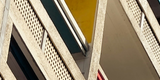
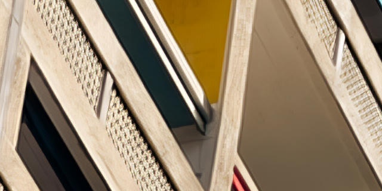
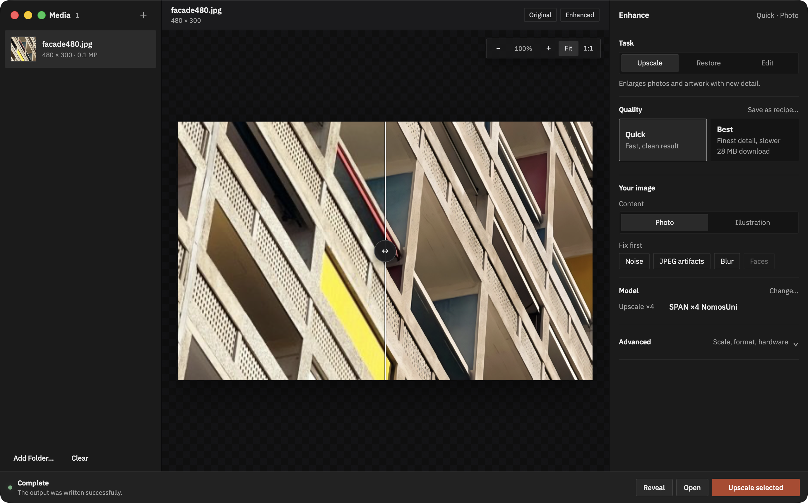

# LocalSR

LocalSR is a free desktop app for upscaling photos, cleaning up noise and blur,
and enhancing video. Choose an image, pick Quick or Best, and compare the result
with your original. The models run on your computer, and your photos stay there too.

There is also a small [phone app](#phone-app) for Android and iPhone that upscales
photos on the phone itself.

Get it from the [download page](https://localsr.com/download/), or
[try it in your browser](https://localsr.com/demo/) first. The
[user guide](https://localsr.com/guide/) explains the app, and the
[changelog](CHANGELOG.md) lists what changed in each version.

| Original detail | LocalSR, 4× with Quick |
| --- | --- |
|  |  |

*A real result from SPAN NomosUni, with no added sharpening. Photo by
[Tim Ziegelbaum](https://unsplash.com/photos/modern-apartment-building-with-colorful-balconies-against-blue-sky-n4bofMDUS_Y).
[Image credits and processing details](docs/assets/README.md).*



## Why I built it

LocalSR started out of necessity. For a long time I upscaled pictures with the
HAT-L models, but only through the terminal. At some point I wanted a proper app
for it, and most of what I found was subscription-based, really complicated or
outdated. So the decision was clear. With the help of Claude and a clear idea of
what I wanted, I built a super-resolution app that puts research-level models in
one place and runs them on your own computer. The results are impressive, but
they are not my work. My work is making these niche but incredible models a lot
more accessible. They are meant to be used anyway: every model the app downloads
is published under an open licence (Apache-2.0, BSD-3-Clause, MIT or CC BY 4.0
at the moment), and the app shows you each licence before it downloads anything.

## What it does

- Enlarge photos and artwork by 2×, 3× or 4×. Quick is a good start, and Best
  spends more time on photo detail.
- Clean up noise, blur and JPEG artifacts first, or add colour to black-and-white
  photos and videos, then enlarge.
- Paint over dust, scratches and spots on a photo, and LocalSR fills them from the
  picture around them.
- Compare the original and the result with a slider, or hold M to see the
  original.
- Enhance video frame by frame, with the source timing, rotation and audio kept.
- Process a whole folder or a queue, and save a setup as a recipe.
- Edit with a prompt, with FLUX.2 klein, Mage-Flow-Edit-Turbo or Qwen Image Edit.
  This is experimental, and so far FLUX.2 klein and Mage-Flow-Edit-Turbo (CPU on Mac)
  have been tested on a 16 GB Mac.
  [About editing](docs/image-editing.md).

LocalSR also has a built-in benchmark. It times a real upscaling model on fixed
test images, through the same inference engine the app uses for your own files,
and reports how many megapixels per second your CPU or GPU can upscale.

It opens JPEG, PNG, WebP, TIFF, AVIF, GIF, JPEG 2000 and camera RAW files, and
on the Mac also HEIC and JPEG XL. It saves PNG, JPEG, TIFF or WebP, or on the Mac
also HEIC. Videos can be MP4, MOV, MKV, WebM and other common formats, and are
saved as AV1, VP9 or FFV1, or on the Mac also as HEVC or ProRes. [Video support](docs/video-support.md).

Quick uses SPAN NomosUni and Best uses RealPLKSR NomosWebPhoto, both by Philip
Hofmann. The library also has HAT, Real-ESRGAN, SwinIR, NAFNet, SCUNet, FBCNN
and DDColor, and each model shows its size, licence and source before you download it.
The [model guide](docs/models/README.md) describes them, and
[model licences](docs/model-licenses.md) lists each licence.

<!-- release-candidate -->
v0.7.0-beta is in preparation; the downloads below are still v0.6.3-beta.
[Draft release notes](docs/releases/v0.7.0-beta.md).
<!-- /release-candidate -->

## Download

### Which file do I need?

Download one file for your computer; it is all you need. The Mac version includes everything. On Windows and Linux, LocalSR checks your graphics card when it first starts and offers the faster engine for it (NVIDIA CUDA, DirectML for AMD and Intel graphics on Windows, AMD ROCm on Linux), then downloads and installs that engine itself.

| Computer | Download |
|---|---|
| Mac (M1 or newer) | `LocalSR-v0.6.3-beta-macOS-arm64.dmg` |
| Windows | `LocalSR-v0.6.3-beta-Windows-CPU-x86_64.exe` |
| Linux | `LocalSR-v0.6.3-beta-Linux-CPU-x86_64.AppImage`, or `LocalSR-v0.6.3-beta-Linux-CPU-amd64.deb` on Ubuntu and Debian |

### Offline and advanced downloads

Only for a computer without internet access, or to install the GPU edition in one go. Everyone else can skip this.

| Computer | Download |
|---|---|
| Windows, AMD or Intel graphics | `LocalSR-v0.6.3-beta-Windows-DirectML-x86_64.exe` |
| Windows, NVIDIA | `LocalSR-v0.6.3-beta-Windows-CUDA-x86_64.exe` and all `LocalSR-v0.6.3-beta-Windows-CUDA-x86_64.engine.tar.gz.part-*` files in the same folder |
| Linux, AMD | all `LocalSR-v0.6.3-beta-Linux-ROCm-x86_64.AppImage.part-*` files, joined |
| Linux, NVIDIA | all `LocalSR-v0.6.3-beta-Linux-CUDA-x86_64.AppImage.part-*` files, joined |

To import an engine offline, download the `*.engine-payload.json` manifest, its `.engine.tar.gz.part-*` files and their `.sig` signature files into one folder, then open **Advanced -> Engine -> Change… -> Import engine from file…** and choose the `*.engine-payload.json` file.

### What are all the other files?

- `*.engine-payload.json`, `*.engine-update.json` and `*.engine.tar.gz.part-*`: the GPU engines that the app downloads by itself.
- `*.app.tar.gz` and `*.sig`: update files and their signatures, which the app checks before it installs an update.
- `*.sha256` and `SHA256SUMS`: checksums to check a download by hand.
- `*source-and-notices.tar.gz`: the source code and licence notices for each package.

The [download page](https://localsr.com/download/) has the installers
for each platform:

- **macOS v0.6.3-beta:** Apple Silicon (M1 or newer) and macOS 14 or later. Intel
  Macs are not supported. Signed and notarized, and it updates itself.
- **Windows v0.6.3-beta:** Windows 10 or 11 on x86-64. The standard installer
  offers the GPU engine after setup; the DirectML and CUDA installers are for offline use. The installers are unsigned, so SmartScreen warns first: choose
  **More info**, then **Run anyway**. Setup installs for your account (Just me, no
  administrator rights) or for everyone on the computer, lets you choose a folder, add a desktop shortcut and launch
  LocalSR when done; uninstall keeps downloaded models and settings by default.
- **Linux v0.6.3-beta:** x86-64 AppImage. The CPU AppImage offers the CUDA or ROCm
  engine after setup; the CUDA and ROCm AppImages are for offline use. The CPU
  AppImage runs Intel graphics through OpenVINO once Intel's compute driver
  (`intel-opencl-icd`) is installed. After first setup, it offers once to add
  LocalSR to your applications menu, removable later from the Help menu. From
  0.6.0-beta, Ubuntu 22.04+ and Debian 12+ can install the CPU edition as a .deb
  with `sudo apt install ./LocalSR-v<version>-Linux-CPU-amd64.deb`. It adds its
  own menu entry and downloads the CUDA or ROCm engine inside the app. It reports
  new versions; install the new .deb with apt the same way.

The CUDA edition needs an NVIDIA RTX 20 series or newer and driver 580 or
newer. On Windows, older NVIDIA cards can use DirectML.

On a Mac you can also install it with [Homebrew](https://brew.sh/):

```bash
brew install --cask herrei/tap/localsr
```

The Mac app takes about 1.2 GB, because it brings its own Python and PyTorch.
Models download when you choose them: Quick is 4.5 MB, most others are under
500 MB, and the editing models are 5 to 26 GB. To keep models on another drive,
change the model folder under Advanced settings. I test upscaling on a Mac with
16 GB of memory.

LocalSR is only published on
[GitHub Releases](https://github.com/HerRei/local-upscale/releases), on
[localsr.com](https://localsr.com/) and through the
Homebrew cask, which all use the same files. Each file has a SHA-256 next to it.
The Mac app is signed as `Developer ID Application: Hermes Reisner (Z2TU844D84)`;
`spctl -a -vv /Applications/LocalSR.app` shows it.

## Phone app

LocalSR also exists as a small app for phones, with its own version numbers
(1.0.0 first). It upscales photos 4× on the phone itself, with two built-in models
and no network access. Videos, Restore and the larger models stay in the desktop app.

- **Android:** Android 10 or later.
  [Download the APK](https://github.com/HerRei/local-upscale/releases/download/mobile-v1.0.0/LocalSR-mobile-1.0.0-android.apk)
  (28 MB, [release notes and checksum](https://github.com/HerRei/local-upscale/releases/tag/mobile-v1.0.0)),
  also on [itch.io](https://herrei.itch.io/localsr). Open the file on the phone and
  allow the install once.
- **iPhone:** iOS 27 or later,
  [on the App Store](https://apps.apple.com/app/id6837801876).

More on the [phone app page](https://localsr.com/phone/). The source
is in [mobile/](mobile/README.md), and its changes are in
[mobile/CHANGELOG.md](mobile/CHANGELOG.md).

## Limits

- Upscaling reconstructs detail. Faces, text and fine patterns can look sharp
  and still differ from the real scene, especially at 4×. Results are saved as
  new files, so your originals stay untouched.
- Video is upscaled one frame at a time, so fine detail can flicker.
- Large images and long videos can take hours. Try a small one first.
- I test the Mac build the most; DirectML and CUDA less.
- On Windows and Linux, phone videos (H.264, HEVC, AAC) need an FFmpeg you
  install yourself. On the Mac they open through the system.

The full list is in [Known limitations](KNOWN_LIMITATIONS.md), and the testing
details are in [platform support](docs/platforms.md).

## What leaves your computer

There is no account, and your images and videos are never uploaded.

A fresh install starts with a two-page setup, and nothing goes over the network
before you finish it. The first page covers privacy: automatic update checks, an
anonymous update count and crash reports. All three are on by default, and you
can switch each one off there or later in Settings. The second page sets the
look: theme, colour-blind friendly colours, high contrast, the menu bar icon and
the finish sound. Installs that already made these choices keep them.

- **Update check:** at launch, LocalSR reads its update feed on GitHub Pages
  (for the beta, `localsr.com/updates/beta.json`) and can update
  itself on the Mac, on Windows and as a Linux AppImage. **Check for Updates…**
  still works when you ask. Updates come from GitHub Releases, and the app checks
  their signature before it replaces anything.
- **Anonymous count:** after a check, the app sends the app version, platform
  and channel to my Mac mini at `macmini-ci.tail34a4e0.ts.net`, without an
  install ID or cookies.
- **Crash reports:** stored only on your computer and never sent automatically.
  You can read a report and choose to open a GitHub issue with it. A report holds
  the app and system versions, the device kind, the running task and model, and
  redacted error details. Native crashes such as segmentation faults may not be
  captured.

The update switches are also in the LocalSR menu on the Mac, the Help menu on
Windows and Linux, and the Software Update dialog. The Microsoft Store edition
neither checks for updates nor sends the count.

Models download from their authors on GitHub or Hugging Face when you choose
them, and the face-detection model downloads the first time a face-aware job
runs. Once your models are downloaded, LocalSR works offline.
[Privacy details](https://localsr.com/privacy/).

## FAQ

**Why is it free?** It's my own project, made alongside uni. There is no paid
version, no account and no advertising, and the code is MIT licensed.

**Can I use my own models?** Yes, compatible `.safetensors` files work as a
custom checkpoint for upscaling and restoration. `.pth`, `.pt` and `.ckpt`
files can run code when they load, so the app only uses one after you tick
*Allow this pickle-based checkpoint*. Do that only for files from a publisher
you trust. The app remembers approval for that file’s SHA-256; changed files need approval again.
You can name and select your checkpoints in the model library. For editing, **Use your own edit model…** in the model library lets
you pick local GGUF/safetensors component files for Qwen Image Edit 2511,
Qwen Image 2.1, FLUX.2 klein, or Mage-Flow-Edit-Turbo.

**How do I uninstall it?** On a Mac, move LocalSR to the Trash and delete
`~/Library/Application Support/LocalSR` and `~/Library/Caches/LocalSR`. On
Windows, uninstall it under Apps and delete `%LOCALAPPDATA%\LocalSR`. On Linux,
delete the AppImage or run `sudo apt remove localsr`, then delete
`${XDG_DATA_HOME:-~/.local/share}/LocalSR`. The
[guide](https://localsr.com/guide/) has the details.

## Build from source

You need Python 3.11, Node.js, a stable Rust toolchain and
[Tauri's platform prerequisites](https://v2.tauri.app/start/prerequisites/).

```sh
./local-ci.sh setup
cd desktop && npm run tauri -- dev
```

The interface is Svelte in Tauri, with a Rust host for the queue, settings and
updates, and a separate Python worker that runs PyTorch and spandrel. Run
`./local-ci.sh` for the local checks. More in the
[desktop guide](desktop/README.md), the [worker protocol](protocol/README.md),
the [command line](docs/automation.md) and [releasing](docs/releasing.md) docs.

The iPhone and Android app is a separate Swift project built with Skip, in
[mobile/](mobile/README.md).

## Feedback

Please report bugs on [GitHub Issues](https://github.com/HerRei/local-upscale/issues)
with your app version, model, device and the steps that led to the problem.
*Copy diagnostics* in the app adds the hardware details. For security reports,
see [SECURITY.md](SECURITY.md). For anything else:
[hermes.reisner@gmail.com](mailto:hermes.reisner@gmail.com).

## Licence

LocalSR is [MIT licensed](LICENSE). Models keep their authors' licences, shown
in the app before download. Bundled libraries are listed in
[THIRD_PARTY_NOTICES.md](THIRD_PARTY_NOTICES.md), and each release includes the
source of its LGPL components.
